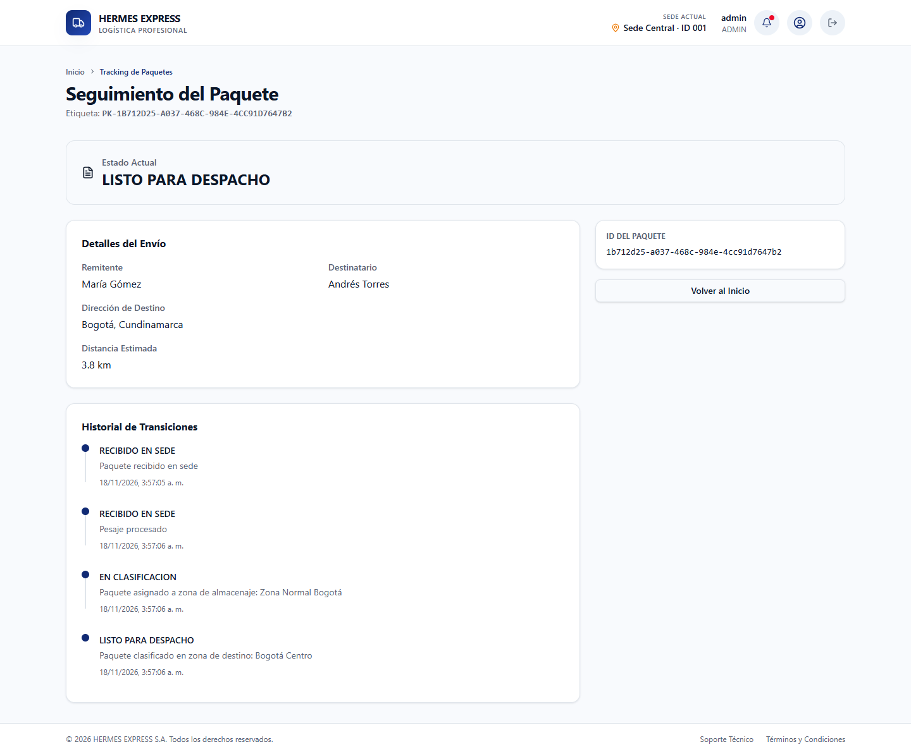
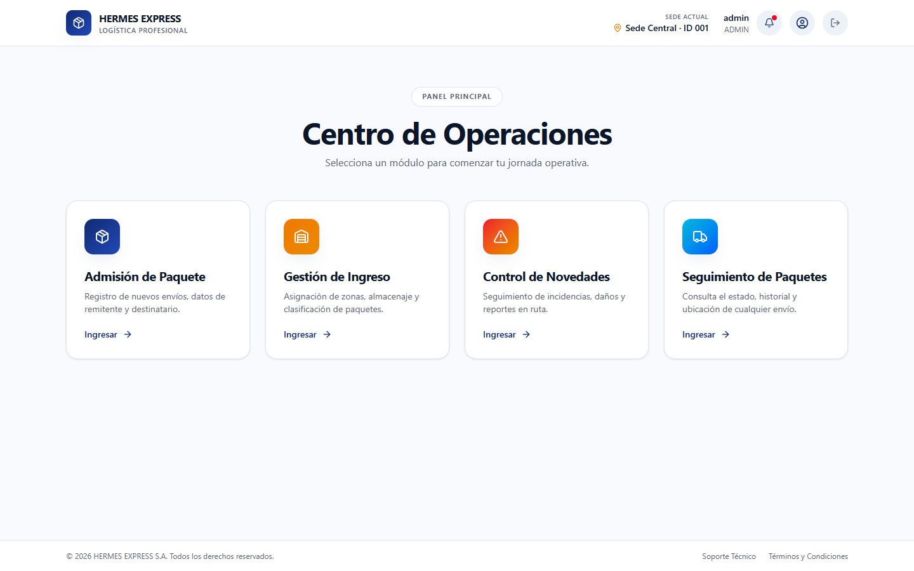
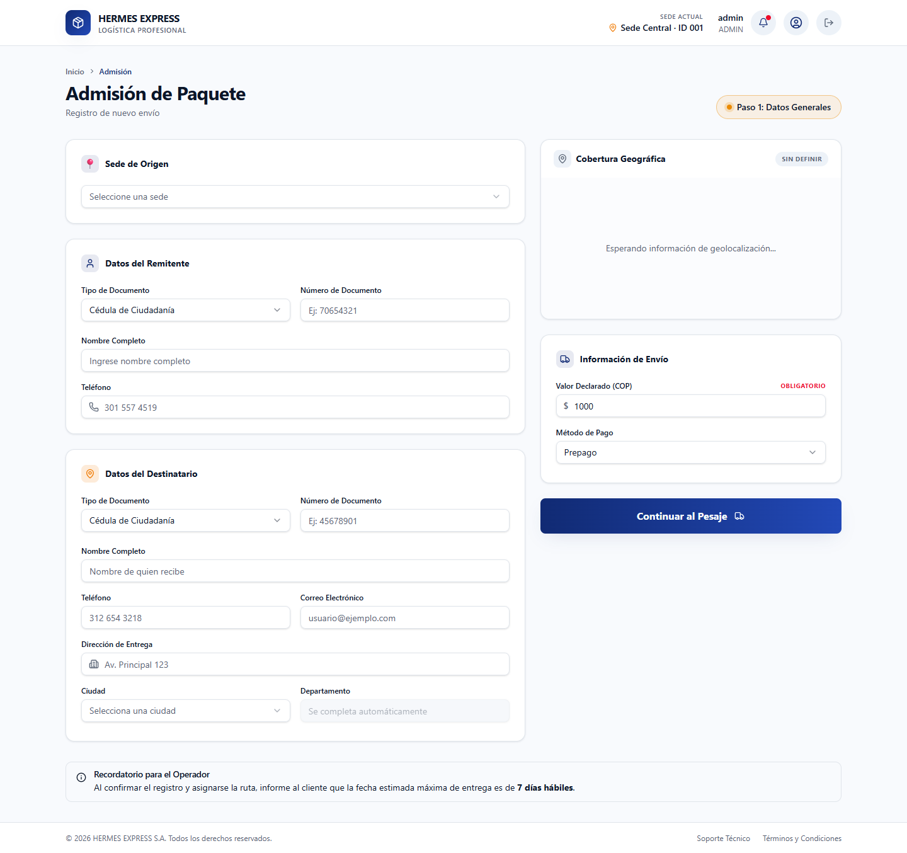
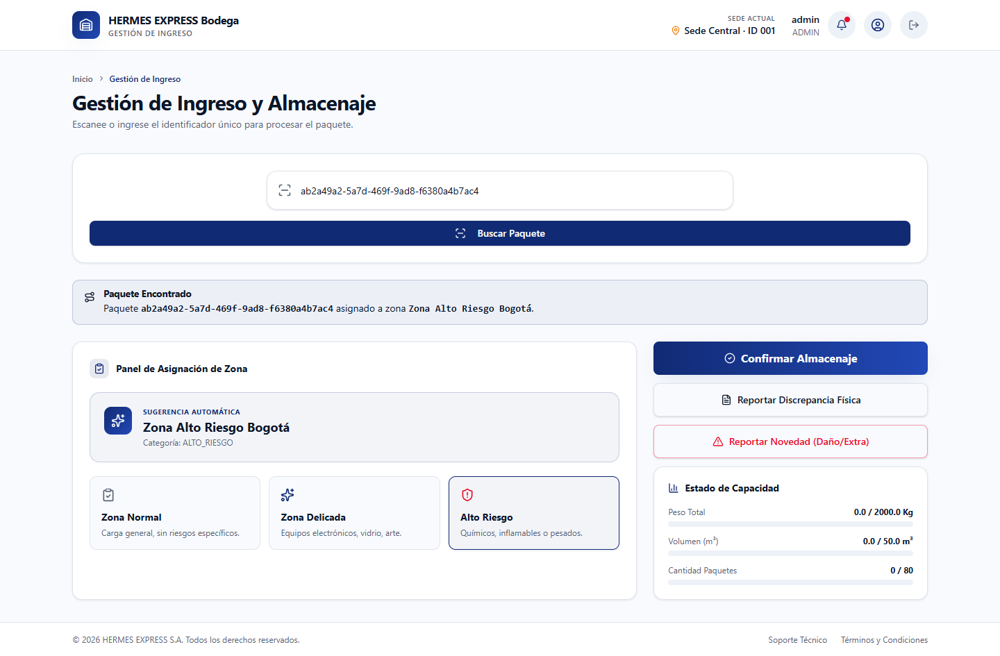
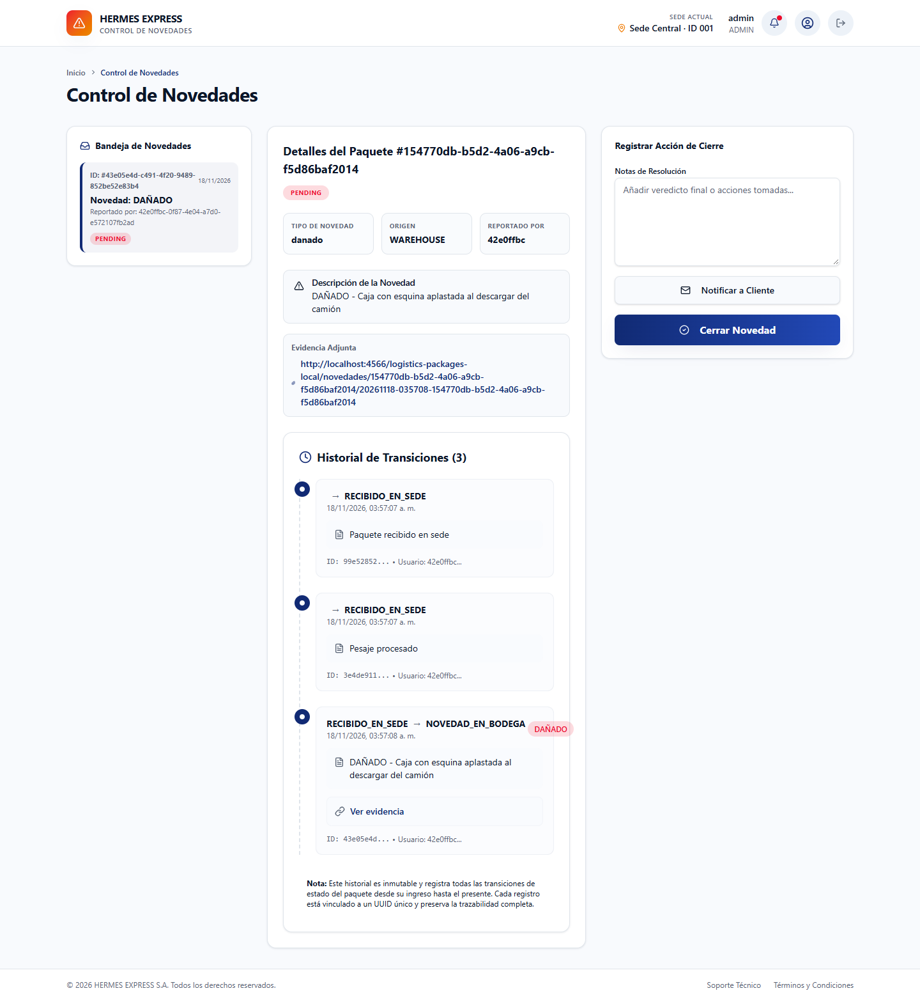
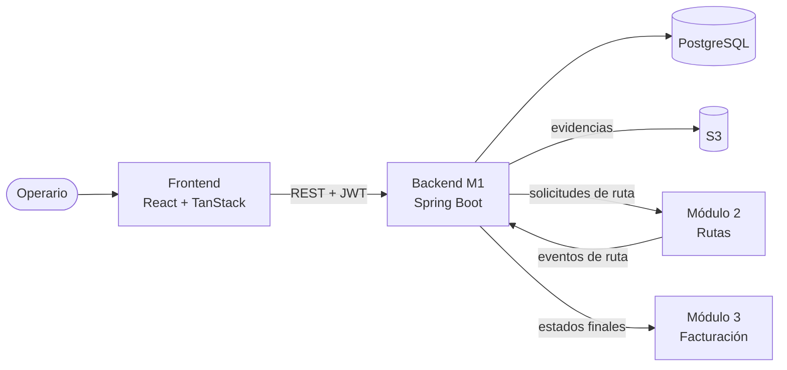

# Logistics Packages — Módulo 1: Gestión de Paquetes

[](https://github.com/Bryan-Robles/logistics-packages/actions/workflows/ci.yml)


Sistema de gestión logística que sigue cada paquete desde que entra a la sede: admisión, pesaje, almacenaje, clasificación por zona de destino, solicitud de ruta y gestión de novedades, con historial completo de estados.

Proyecto académico desarrollado en equipo (Universidad del Magdalena, 2026-1). Es el **Módulo 1** de un sistema de tres módulos (Paquetes, Rutas y Facturación) que se comunican por AWS SQS.

> **Estado: archivado.** El desarrollo terminó con el semestre. Este repositorio es una versión consolidada y estabilizada de lo entregado: no agrega funcionalidades nuevas. Ver [Alcance y limitaciones](#alcance-y-limitaciones).



## Funcionalidades

| Caso de uso | Backend | Frontend |
| --- | --- | --- |
| UC-001 Admisión de paquete, con geocodificación o coordenadas manuales | `POST /api/paquetes/admision` | `/admision` |
| UC-002 Pesaje y dimensiones: peso volumétrico, categoría de carga, precio y alertas | `POST /api/paquetes/pesaje` | `/pesaje` |
| UC-003 Solicitud de ruta al Módulo 2 | evento SQS | automático tras el pesaje |
| UC-004 Preparación para almacenaje (zona sugerida, capacidad, discrepancias) | `/api/paquetes/{id}/almacenaje` | `/gestion` |
| UC-005 Clasificación por zona de destino | `/api/paquetes/clasificacion/*` | `/clasificacion` |
| UC-006 Estado según eventos de ruta del Módulo 2 | listener SQS | `/tracking` |
| UC-007 Novedades en bodega (dañado / extraviado) con evidencia en S3 | `/api/paquetes/{id}/novedades` | `/reportar-novedad`, `/novedades` |
| Autenticación JWT | `/api/auth/login`, `/api/auth/register` | `/login`, `/register` |

<table>
  <tr>
    <td></td>
    <td></td>
  </tr>
  <tr>
    <td></td>
    <td></td>
  </tr>
</table>

## Arquitectura



- **Backend con arquitectura hexagonal:** `domain` (modelo y reglas, sin Spring), `application` (un caso de uso por operación y sus puertos) e `infrastructure` (REST, JPA, SQS, S3, Google Maps, SMTP).
- **Frontend por capas:** `domain`, `application`, `infrastructure` y `presentation`.

Diagramas de capas, del ciclo de vida del paquete y del flujo de admisión en [docs/ARQUITECTURA.md](docs/ARQUITECTURA.md).

## Stack

| Capa | Tecnologías |
| --- | --- |
| Backend | Java 21, Spring Boot 3.2, Spring Security + JWT, Spring Data JPA, Flyway, PostgreSQL 16 |
| Mensajería y almacenamiento | AWS SQS y S3 con Spring Cloud AWS; LocalStack en local |
| Frontend | React 19, TypeScript, TanStack Start / Router / Query, Tailwind CSS 4, shadcn/ui, React Hook Form + Zod |
| Calidad | JUnit 5, Mockito, Testcontainers, ESLint, Prettier, GitHub Actions |
| Infraestructura | Docker, Docker Compose |

## Ejecutar en local

Requisito: Docker.

```bash
cp backend/.env.example backend/.env
docker compose up --build
```

| Servicio | URL |
| --- | --- |
| Aplicación | http://localhost:3000 |
| API | http://localhost:8080 |
| Swagger | http://localhost:8080/swagger-ui.html |

Usuarios de desarrollo (solo locales): `admin` / `admin123` y `operador` / `operador123`.

Sin `GOOGLE_MAPS_API_KEY`, la admisión deja el GPS en `PENDIENTE` y las coordenadas se ingresan a mano (contingencia prevista en el UC-001).

Para desarrollar cada parte por separado, ver [backend/README.md](backend/README.md) y [frontend/README.md](frontend/README.md).

## Calidad

```bash
cd backend && ./gradlew test         # 208 tests: unitarios + integración con Testcontainers (requiere Docker)
cd frontend && npx tsc --noEmit      # 0 errores de tipos
cd frontend && npm run lint          # 0 errores
```

La integración continua corre las tres verificaciones en cada push. El flujo completo se verificó contra el stack local: login, admisión, coordenadas manuales, pesaje, almacenaje, clasificación, tracking y novedad con evidencia.

## Alcance y limitaciones

- **Módulos 2 y 3:** la integración real dependía de las cuentas AWS de otros equipos. En local, M1 publica sus eventos en LocalStack, pero nadie los consume ni responde, así que no se llegan a asignar rutas.
- **Notificaciones:** los SMS están simulados (se escriben en el log) y el email requiere credenciales SMTP.
- **Frontend:** algunas pantallas tienen datos de ejemplo y quedan tipos `any` sin precisar (aparecen como warnings de lint).

## Mi aporte

<!-- BORRADOR: revisar y ajustar con tu propia experiencia antes de publicar -->

- **Análisis y especificación:** redacción de los casos de uso UC-001 a UC-003 y del diagrama de casos de uso.
- **Backend:** plan de ejecución e implementación del pesaje (UC-002), configuración de Testcontainers y Docker Compose, corrección de errores en la admisión y el pesaje, DTO de personas y adaptador SQS para clasificación.
- **Frontend:** scaffolding inicial, alineación de la maqueta con las especificaciones, e integración con la API real de los flujos de admisión → pesaje, almacenaje → clasificación y discrepancias, además del flujo completo de novedades (UC-007).
- **Después de la entrega:** consolidación en este monorepo, limpieza del historial (credenciales y artefactos), estabilización (tests en verde, tipado, bugs de integración), Docker Compose de un solo comando y CI.

## Equipo

Carlos Sehuanes · Bryan Robles · Karyme Sánchez · Juan Rivera

Repositorios originales: [backend](https://github.com/InsoftUnimag/20261LogisticsPackages) · [frontend](https://github.com/Csehuanes-code/20261LogisticsPackagesFrontend). Este repositorio conserva el historial completo de ambos. Se eliminaron del historial artefactos de build y credenciales que se habían subido por error.
