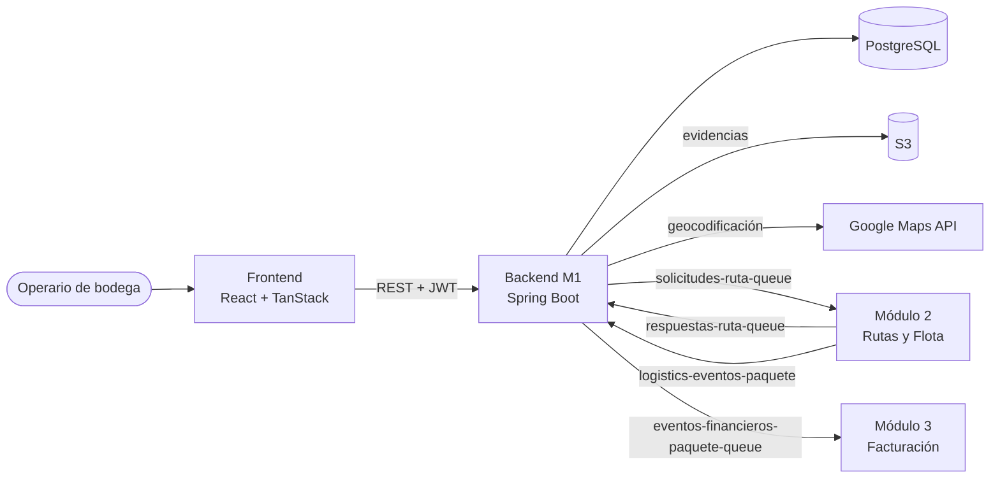
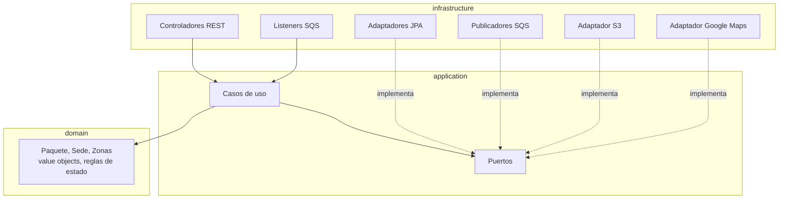
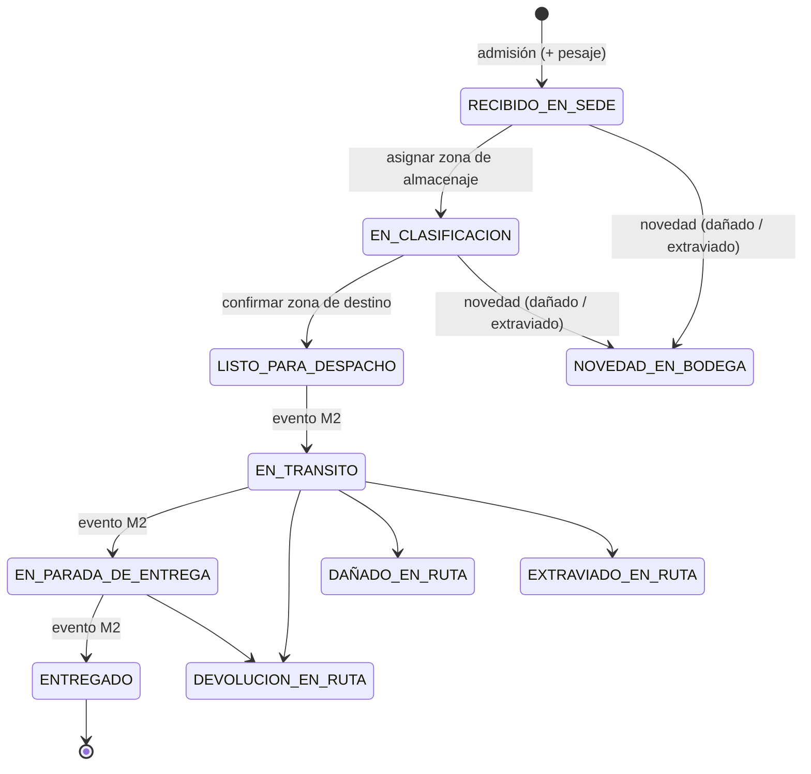
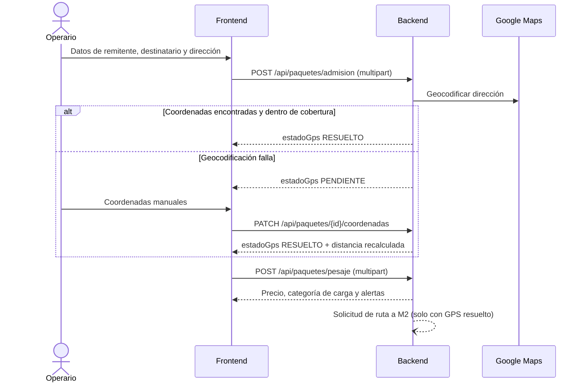

# Arquitectura

## Contexto del sistema

El sistema logístico tiene tres módulos que se comunican por colas AWS SQS. Este repositorio implementa el **Módulo 1 (Gestión de Paquetes)**.

En local, S3 y SQS se emulan con LocalStack. Los módulos 2 y 3 no forman parte de este repositorio.

## Arquitectura hexagonal (backend)

- **domain**: el modelo y sus reglas (transiciones de estado, validaciones de peso y dimensiones, evidencia obligatoria). No depende de Spring.
- **application**: un caso de uso por operación (admisión, pesaje, almacenaje, clasificación, novedades, eventos de ruta) y los puertos que necesita.
- **infrastructure**: adaptadores de entrada (REST, SQS) y de salida (JPA, SQS, S3, Google Maps, SMTP).

## Ciclo de vida del paquete

Cada transición queda registrada en `historial_estados`, con el usuario, las observaciones y la URL de evidencia si la hay. Los estados finales se publican al Módulo 3.

## Flujo de admisión y geocodificación

